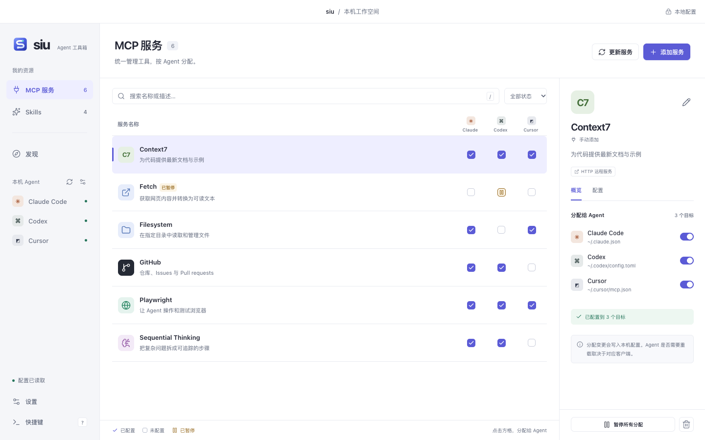
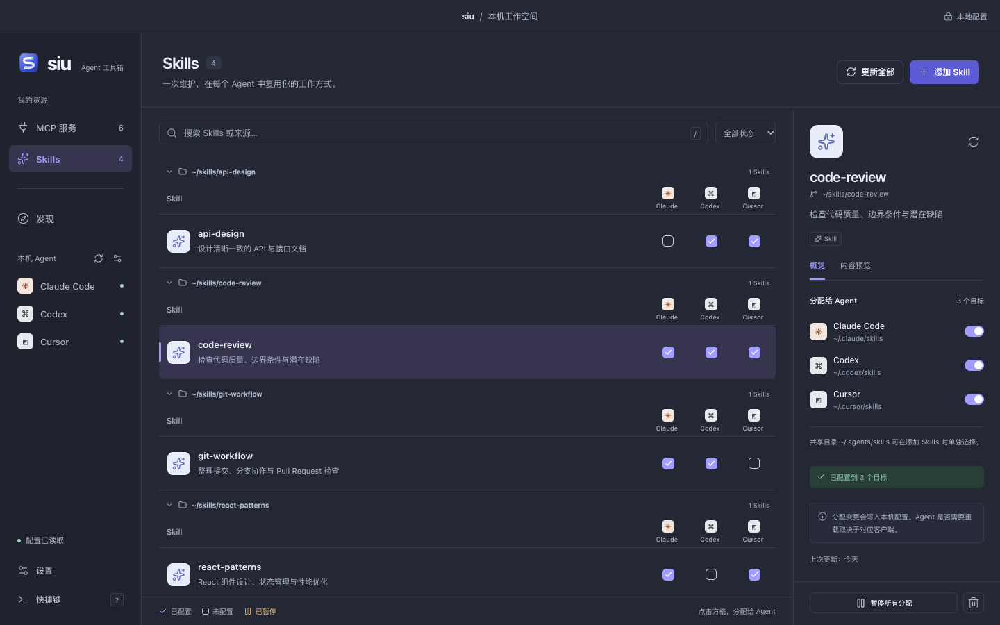

# Siu

在一个资源库里管理多个编码 Agent 的 MCP 服务和 Skills。桌面版用「资源 × Agent」矩阵查看分配与写入状态，终端版 `siu-tui` 可直接在 SSH 会话中使用。两者共用 Go 核心，并与上游 `siu` 共用本机资源库。 [上游 siu](https://github.com/nicholasxjy/siu)

[下载与版本](https://github.com/nicholasxjy/siu-project/releases/latest) · [更新记录](CHANGELOG.md)

Skills 管理界面

## 安装与启动

按系统和 CPU 架构选择安装包。Intel Mac 选 `x64`，Apple Silicon 选 `arm64`。Windows 和 Linux 使用与机器架构对应的 `x64` 或 `arm64` 包。桌面包前缀从下一个发行版起改为 `siu-project_`，较早版本可按平台和扩展名查找。

| 平台    | 桌面版                                         | 终端版 `siu-tui_…`                    |
| ------- | ---------------------------------------------- | ------------------------------------- |
| macOS   | `.dmg`，另有 Universal DMG 和 ZIP              | `.tar.gz`，按架构选择                 |
| Windows | `_setup.exe`                                   | `.zip`                                |
| Linux   | `.deb` 或 `.tar.gz`，需 GTK 3 和 WebKitGTK 4.1 | `.tar.gz`，可在无图形界面的服务器运行 |

终端包解压后，在包内运行 `./siu-tui`。Windows PowerShell 中运行 `.\siu-tui.exe`。如果发布页还没有对应的终端包，可从源码运行 `go run ./cmd/siu-tui`，或用 `bun run build:tui` 打包。 [构建说明](docs/building.md#终端版)

## 管理 MCP 与 Skills

- **MCP** 支持 stdio、HTTP 和 SSE。可以手动配置、从 MCP Registry 搜索安装，或导入 Agent 中已有的服务。凭据在配置预览中默认遮蔽。
- **Skills** 可从 GitHub 仓库、本地目录或 skills.sh 安装。扫描后按项选择、分配给 Agent，并查看已纳管的 `SKILL.md`。
- **分配与同步** 支持 Claude Code、Codex、Gemini CLI、OpenCode、Cursor、Copilot CLI、Droid、Pi、Grok 和 Antigravity 等集成。应用按本机配置目录检测 Agent，并根据 Agent 能力提供分配选项。「已配置」表示写入成功。需要时在 Agent 内重载配置，写入失败可在 Siu 重试。
- **设置** 可配置网络代理、导入导出备份和分类型清空资源。桌面版另提供用户级指令文件编辑，可管理 `AGENTS.md`、`CLAUDE.md` 等文件。

### 终端快捷键

| 操作                       | 按键                      |
| -------------------------- | ------------------------- |
| 切换 MCP、Skills 和设置    | `Tab` / `Shift+Tab`       |
| 移动、打开、返回           | `↑` / `↓`、`Enter`、`Esc` |
| 在资源首页添加、发现、筛选 | `A`、`D`、`/`             |
| 切换勾选、继续             | `Space`、`Enter`          |
| 确认删除、清空或恢复       | `Y`                       |
| 在首页刷新、退出           | `R`、`Q`                  |

## 资源库与备份

资源库默认位于 `~/.siu`。可用 `SIU_HOME` 修改位置。桌面版、`siu-tui` 和上游 `siu` 共用库时，请一次只用一个客户端写入。已有的未纳管配置可从资源列表显式导入。

迁移时先导出 JSON，再到目标机器预览并确认导入。备份携带 MCP 凭据、Skills 文件、Agent 分配和代理设置。恢复会替换已纳管资源，并先保存当前配置的备份。 [备份、自动恢复与回滚](docs/backup.md)

## 开发文档

- [构建与分发](docs/building.md)
- [测试与原生验证](docs/verification.md)
- [Go 核心接口](docs/protocol.md)

## 许可

[MIT](LICENSE) · [第三方许可与来源](THIRD_PARTY_NOTICES.md)
