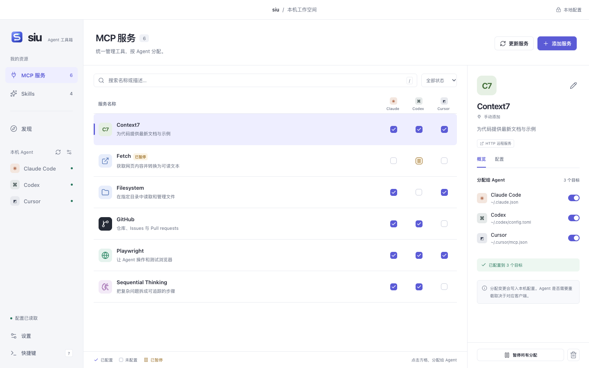
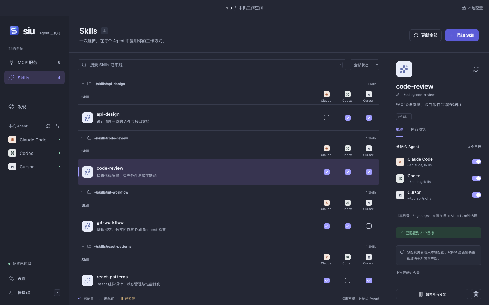

# siu GUI

[siu](https://github.com/nicholasxjy/siu) 的桌面界面，统一管理 coding agent 的 MCP 服务与 Skills。基于 [mygo](https://github.com/egoist/mygo)、React 和 siu Rust 核心，使用系统 WebView。

[下载安装包](https://github.com/nicholasxjy/siu-gui/releases/latest) · [更新记录](CHANGELOG.md)

## Demo

MCP 服务：通过「资源 × Agent」矩阵分配工具，查看配置与同步状态。



<details>
<summary>Skills 管理 · 深色主题</summary>



</details>

截图使用隔离示例数据，由真实界面与 Go/Rust 后端运行生成。

## 功能

- **MCP 管理**：添加、编辑、导入、分配、暂停和更新服务，支持 stdio、HTTP、SSE。
- **Skills 管理**：扫描 GitHub 仓库或本地目录，选择安装、按来源分组、预览 SKILL.md 并更新。
- **配置迁移**：导出单个 JSON 文件，包含 MCP 配置、Skills 文件、启用状态、Agent 分配、代理设置和主题；在另一台机器导入后恢复。
- **资源发现**：搜索 MCP Registry 与 skills.sh，按安装描述符填写配置，网络异常时提示缓存回退。
- **本机集成**：检测 Agent、共享 siu CLI 资源库，支持深浅主题、系统或手动代理和原生文件夹选择。

支持 macOS、Windows、Linux 的 x64 / ARM64；macOS 另提供通用构建。平台依赖见[构建说明](docs/building.md)。

## 使用说明

- 资源库默认在 `~/.siu`，可用 `SIU_HOME` 指定。与 siu CLI 共用数据；启动和刷新会检测下述 `config.json` 自动恢复入口，其他情况只读取配置。
- 修改配置前备份原文件并保留无关内容；同名未托管资源需明确导入。备份保存在资源库的 `backups/`。
- 「已配置」表示配置写入成功，Agent 的重载与 MCP 运行状态由对应 Agent 决定。
- 凭据预览默认遮蔽，本机配置文件仍保存实际值。网络策略可在「设置 → 网络」中切换并立即生效；Docker 镜像下载需另配 Docker 引擎代理。

### 导入和导出配置

在「设置 → 配置迁移」点击「导出 JSON」，选择保存位置。将文件复制到另一台机器后，在 siu 的同一位置点击「导入 JSON」，查看资源数量和提示，再确认恢复。

也可以把导出的 JSON 直接保存或复制为 `~/.siu/config.json`（设置了 `SIU_HOME` 时为 `$SIU_HOME/config.json`）。启动 siu 或刷新界面时会自动恢复，同样先备份当前资源库。成功后在 `config.applied.json` 记录摘要，相同文件不会重复恢复，也不会覆盖你之后在界面中的修改；替换文件内容后会再次应用。文件无效时会显示错误并保留现有配置，移除 `config.json` 不会撤销已恢复的资源。

恢复会将 **siu 管理的全部 MCP 与 Skills 替换为备份状态**，包括启用/暂停和 Agent 分配，保留 Agent 中其他未纳管的条目。恢复前的资源库会自动备份为 `backups/config-*.json`，也可以用同一入口导入该文件。Skills 的文档、脚本和二进制资源直接包含在 JSON 中，恢复无需重新下载。导入会重建本机 Skills 链接，并适配配置中以原用户目录或资源库目录开头的路径。尚未安装的 Agent 保留分配，安装并启动后点击「重试写入」进行同步。

JSON **包含明文 API 密钥、请求头和代理凭据**，请妥善保管。备份只迁移 siu 管理的资源定义与文件；MCP 需要的 Node/Python、Docker 镜像、外部脚本，以及 Agent 本身须在目标机器准备。原用户目录之外的绝对路径、不同操作系统的启动命令及本地代理地址可能需要手动调整。备份不包含 Agent 的其他独立设置。单个 JSON 最大 128 MiB，Skills 文件总大小最大 64 MiB、最多 20,000 个文件；不支持的文件路径和外部符号链接会明确报错。

## 开发

工具链与平台依赖见[构建说明](docs/building.md)。

```sh
bun install --frozen-lockfile
bun run dev
```

`dev` 会编译 Rust 核心并启动桌面窗口；单独运行 `dev:web` 无法访问本机配置。`bun run build` 的产物位于 `build/<os>-<arch>/`。

- [构建与分发](docs/building.md)：工具链、打包、签名与发布。
- [验证指南](docs/verification.md)：测试命令、隔离环境与验证范围。
- [接口协议](docs/protocol.md)：桌面 IPC、核心方法与数据结构。
- [上游来源](core/UPSTREAM.md)：固定版本与桌面适配。

## 许可

[MIT](LICENSE)。第三方组件与上游许可见 [THIRD_PARTY_NOTICES.md](THIRD_PARTY_NOTICES.md)。
